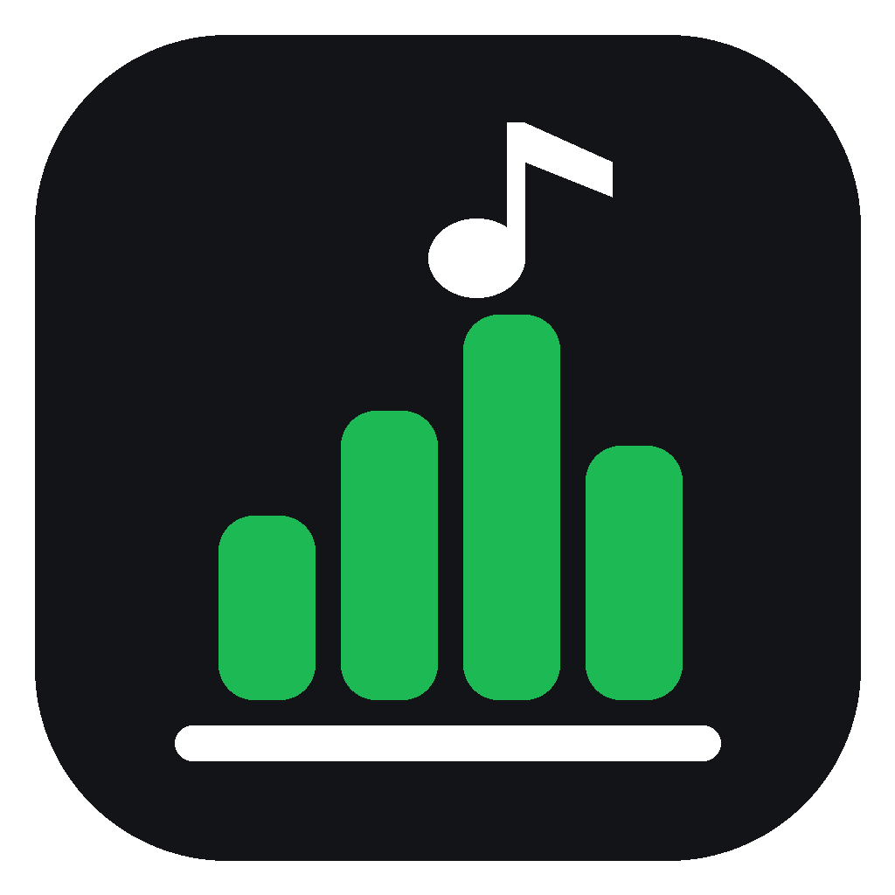

# festify

**Paste an Instagram concert post, get a Spotify playlist of the bands playing.**

festify reads a show poster (or screenshots of one), works out which artists are on it, finds each one's top songs and builds one private Spotify playlist per event, with the post image as the cover. It's built for small local shows, where the hard part isn't Spotify but *identity*. A band called "Helper" or "World Record" from your town shares its name with several unrelated artists around the world, and most tiny bands have no Wikipedia page, no MusicBrainz entry and no location data anywhere in Spotify's API.

It never stops to ask questions. Anything it isn't sure about is written into the **playlist description** on Spotify, e.g. `Maybe another band with the same name: Helper. Not on Spotify: Gene Freak.`

> This is a personal project built with an AI coding assistant (Claude Code). The **[case study](CASE_STUDY.md)** covers the problem, my decisions and how I tested it; the design notes below cover the trade-offs.

## How it works

```
Instagram link / screenshots
  │  instaloader (post images, caption, tagged @accounts, posting account)
  ▼
Read the poster            Gemini (free) vision: event, date, city, lineup; tags fill in illegible logos
  ▼
For each band:
  1. The band's own link   its Instagram bio (read via Tavily), Linktree / bio links, album or track links
  2. Candidates            Deezer + Spotify + Last.fm artists with exactly that name
  3. Where are they from   MusicBrainz areas + web-search snippets (Tavily), attributed by the LLM,
                           geocoded with OpenStreetMap and measured against YOUR cities
  4. Decide (rules first)  only one local candidate → it; confident nearby pick → it;
                           several plausible nearby → up to 3, songs split 3/2/1; far away → left out
  ▼
Top songs                  Deezer / Last.fm top tracks matched on Spotify by ISRC
  ▼
Spotify playlist           private, post image as cover, warnings in the description
```

## Setup

You need Python 3.10+ and a **Spotify Premium** account (Spotify requires it to own a developer app). Everything else is free.

### 1. Install

```bash
git clone <this-repo-url> festify
cd festify
python -m venv .venv
.venv\Scripts\activate          # macOS/Linux: source .venv/bin/activate
pip install -r requirements.txt
copy .env.example .env          # macOS/Linux: cp .env.example .env
```

### 2. Keys (put them in `.env`)

| Key | Where | Needed? |
|---|---|---|
| `SPOTIFY_CLIENT_ID`, `SPOTIFY_CLIENT_SECRET` | <https://developer.spotify.com/dashboard>, then **Create app**, set the Redirect URI to exactly `http://127.0.0.1:8888/callback`, tick **Web API**, and copy both values from **Settings** | required |
| `GEMINI_API_KEY` | <https://aistudio.google.com/apikey> (free tier, no billing) | required |
| `TAVILY_API_KEY` | <https://tavily.com> (1,000 free credits/month, no card) | strongly recommended: reads bands' Instagram bios and finds their pages |
| `LOCAL_CITIES` | your own list, e.g. `Provo, UT; Salt Lake City, UT` | strongly recommended: "local" means near these (plus the poster's city) |
| `LASTFM_API_KEY` | <https://www.last.fm/api/account/create> | recommended |
| `MUSICBRAINZ_CONTACT` | your email or a URL | recommended (MusicBrainz and OpenStreetMap ask for contact info) |
| `IG_USERNAME` | a spare Instagram account, see below | optional |
| `ANTHROPIC_API_KEY` | paid alternative to Gemini (`--claude`) | optional |

`.env` is gitignored. Never commit it.

### 3. Run the app

Double-click **`Festify.bat`** (Windows) or run `python -m festify.gui`. A page opens at `http://127.0.0.1:8765` (reachable only from your computer):

1. Paste an Instagram post link (or drop screenshots).
2. Click **Build playlist**.

The first run opens a browser tab to authorize Spotify. The result card shows the playlist link and any warnings. **More options** has your local cities, preview-only mode, songs per band, "Fix a band" pins and **Update all saved playlists**. Every run's log is saved in `logs/`, and **Copy log** copies it for troubleshooting.

Running the same post again updates its playlist instead of making a duplicate.

### Command line

```bash
python -m festify https://www.instagram.com/p/XXXX/          # build / update the playlist
python -m festify poster.png screenshots_folder/ --dry-run    # preview, create nothing
python -m festify --events-file events.json                   # refresh every saved event
python -m festify --pin "Skrude=https://open.spotify.com/artist/<id>" --events-file events.json
```

| Flag | Meaning |
|---|---|
| `--dry-run` | show everything, create nothing |
| `--tracks N` | songs per band (default 3) |
| `--pin "Name=<spotify artist link>"` | lock a band to an exact Spotify artist |
| `--events-file F` / `--save-events F` / `--events-only` | reuse, save, or only read events (skips re-reading posters) |
| `--no-instagram` / `--no-search` / `--no-geocode` | turn off bio lookups / Tavily / OpenStreetMap |
| `--max-searches N` | Tavily searches per run (default 80; results are cached) |
| `--claude` | use the paid Claude API instead of free Gemini |

## Share it with others (public page)

Double-click **`Public.bat`**. It starts a public version of the page on your PC and a free [Cloudflare quick tunnel](https://developers.cloudflare.com/cloudflare-one/connections/connect-networks/do-more-with-tunnels/trycloudflare/), then opens the public `https://….trycloudflare.com` address. That address is also saved in `logs/public_url.txt`. Anyone with it can paste an Instagram post link and get a playlist. Close the window to stop it.

- **Playlists are made on your Spotify account,** as **public** playlists named `festify · <show> – <date>`. Spotify's API can't create or fill playlist folders: make a "festify" folder in the Spotify app and drag them in. The page also lists recently made playlists.
- **It only accepts Instagram post links.** No uploads or options; your personal app (`Festify.bat`) keeps the pins and settings.
- **Limits protect your free tiers and your Spotify app,** whose Development Mode bans heavy users for hours. You can change them in `.env`:
  - 3 new playlists per visitor per day, 20 a day in total;
  - at most 5 waiting in line, one built at a time;
  - posters with at most 25 bands.
- **A post that was already made returns instantly,** with no API calls.
- **A Spotify ban or a free-tier quota pauses new requests** instead of failing repeatedly.
- **Visitors only see friendly messages.** Details go to `logs/public_<date>.log`, and visitor IP addresses are never written to disk.
- **Optional bot check:** add free [Cloudflare Turnstile](https://www.cloudflare.com/products/turnstile/) keys (`TURNSTILE_SITE_KEY`, `TURNSTILE_SECRET`).
- **It's only online while your PC is on and `Public.bat` is running.** The quick-tunnel address changes every restart.

**Embedding it on a website.** `https://<address>/?embed=1` is a compact version for an iframe. To allow it, list your site in `PUBLIC_EMBED_ORIGINS` (e.g. `https://yourname.com`); every other site is blocked. Because the page is only up while your PC is on, put a short demo GIF next to the embed, or use a "Try it live" button.

**A fixed address on your own domain.** Add the domain to Cloudflare (free plan), then run once:

```bash
cloudflared tunnel login
```
```bash
cloudflared tunnel create festify
```
```bash
cloudflared tunnel route dns festify festify.yourname.com
```

Then create `%USERPROFILE%\.cloudflared\config.yml` with `tunnel: festify`, `credentials-file: <the .json path printed by create>` and an ingress rule sending `festify.yourname.com` to `http://127.0.0.1:8770`. Finally, set `PUBLIC_TUNNEL_NAME=festify` in `.env`, and `Public.bat` will use that address instead of a random one.

Playlists open in Spotify and festify isn't affiliated with Spotify or Instagram. Keep it non-commercial, in line with [Spotify's Developer Terms](https://developer.spotify.com/terms).

## Design notes

**Identity before songs.** Name matching is the main failure mode. In order of trust:
1. Your pin.
2. A Spotify link from the band's own Instagram bio, Linktree, or a page that names their handle. Album and track links count too: the artist credited on that release is used.
3. Distance rules plus an LLM tie-breaker.

Songs are matched across services by **ISRC**, so the songs really belong to the chosen artist rather than a same-name one.

**Distance, not vibes.** Each candidate's evidence (MusicBrainz areas, Bandcamp and Instagram snippets) is turned into places, geocoded and measured against `LOCAL_CITIES`: local ≤ 80 km, regional ≤ 400 km. A far-away artist is never added as an extra guess.

**Never ask.** The playlist is for discovering bands before a show, so a flagged guess is better than a missing band. Uncertainty becomes text in the description, and when several same-name artists are all plausible and nearby, up to 3 are included with fewer songs each.

**Instagram.** Instagram rate-limits profile lookups heavily, even with a logged-in session. festify reads public profiles through Tavily's page reader, and finds untagged bands' handles in web-search results. It does not use proxies or anti-bot tricks. Some accounts' link sections aren't visible to the reader; those bands fall back to the distance rules.

**What isn't possible.** No public API (Spotify, Deezer or Last.fm) says *where an artist's listeners are*. Spotify only shows that to the artist. Distance from your cities is the substitute.

**Spotify's Feb 2026 Development Mode limits** are respected: top tracks, popularity, followers and batch lookups were removed, search returns at most 10 results, and playlists use `POST /me/playlists` and `/playlists/{id}/items`. Dev-mode apps can be rate-limit-banned for many hours, so calls are spaced, capped, cached and never retried in a loop.

**Free and polite.** Every external answer (candidates, MusicBrainz, searches, page reads, geocodes, LLM verdicts, songs) is cached in `.festify_cache.json`, so re-runs cost almost nothing. MusicBrainz and Nominatim are throttled to ≤ 1 request/second with an identifying User-Agent, per their usage policies.

## Measuring accuracy

`tests/golden.json` lists known-correct answers for real poster bands. To re-decide them all from cached evidence, ignoring your pins, run:

```bash
python -m festify.eval
```

It prints right and wrong answers, so rule or prompt changes can be checked before they reach a playlist. Unit tests use mocked APIs and need no keys:

```bash
python -m pytest
```

## Troubleshooting

- **Spotify rate limit / ban:** festify stops cleanly and keeps finished work cached. Re-run later.
- **Gemini quota:** it falls back to other free models, then stops cleanly. Re-run later.
- **Instagram won't load the post:** use screenshots instead; they always work. Optionally save a login with a spare account: `instaloader -l <username>` (or log in on instagram.com in Firefox, close it, and run `instaloader --load-cookies firefox`), then set `IG_USERNAME`.
- **A band is wrong:** use **Fix a band** in the app (or `--pin`), then **Update all saved playlists**.

## Credits and license

Geocoding © [OpenStreetMap](https://www.openstreetmap.org/copyright) contributors, via Nominatim. Artist data from [MusicBrainz](https://musicbrainz.org), [Deezer](https://developers.deezer.com), [Last.fm](https://www.last.fm/api) and [Spotify](https://developer.spotify.com). Web search by [Tavily](https://tavily.com).

MIT, see [LICENSE](LICENSE).
